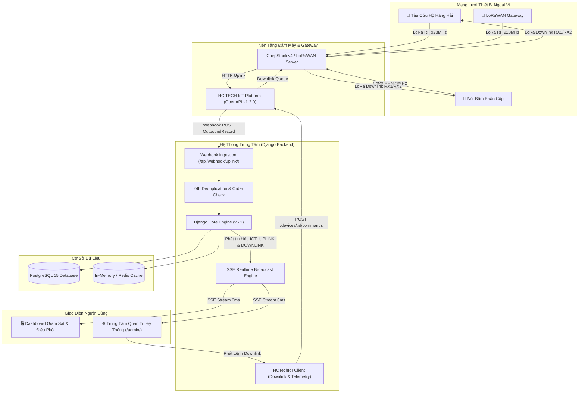

# 🚢 HC TECH IoT & Maritime Emergency Rescue Management Platform

> **Hệ thống Giám sát Hải trình, Điều phối Cứu nạn Hàng hải & Quản trị Nền tảng IoT LoRaWAN Chuẩn OpenAPI v1.2.0**

[](https://www.djangoproject.com/)
[](https://www.python.org/)
[](https://www.postgresql.org/)
[](https://www.docker.com/)
[](file:///home/anhnhat/Documents/tenant_site/Server_tenant/openapi.yaml)
[](#)
[](LICENSE)

---

## 📌 Giới Thiệu Tổng Quan (Overview)

**HC TECH IoT & Maritime Emergency Platform** là giải pháp phần mềm chuyên dụng phục vụ việc theo dõi, điều phối tàu thuyền cứu hộ cứu nạn trên biển, trạm phao hải đăng, nút nhấn khẩn cấp SOS và các thiết bị cảm biến thông minh sử dụng hạ tầng mạng truyền dẫn **LoRaWAN**.

Hệ thống được phát triển theo kiến trúc hướng sự kiện thời gian thực (Event-Driven Realtime), tuân thủ nghiêm ngặt đặc tả tiêu chuẩn công nghiệp **OpenAPI v1.2.0** của nền tảng HC TECH IoT Platform, cho phép thu nhận gói tin Uplink phân tán, xử lý tín hiệu cảnh báo SOS với độ trễ 0ms và phát lệnh điều khiển Downlink ngược xuống thiết bị qua mạng LoRaWAN.

---

## ✨ Tính Năng Nổi Bật (Key Features)

### 1. 🗺️ Bản Đồ Giám Sát & Điều Phối Thời Gian Thực (Interactive Maritime Map)
- **Định vị & Hải trình Tàu**: Theo dõi trực quan vị trí hải trình, vận tốc di chuyển (knots / km/h), trạng thái pin và thời gian phản hồi cuối cùng của từng phương tiện cứu nạn trên nền bản đồ MapVina / OpenStreetMap.
- **Tự động Canh Chỉnh Tầm Nhìn (Auto Zoom-to-fit)**: Khi tải trang, bản đồ tự động tính toán bounding box và zoom mượt mà bao quát toàn bộ vị trí các thiết bị đang hoạt động.
- **Tái Hiện Hành Trình Từng Điểm (GPS Route Replay)**:
  - Vẽ lộ trình di chuyển với từng điểm đo GPS rời rạc; người điều phối có thể nhấp vào bất kỳ điểm nào trên hành trình để tra cứu tọa độ, vận tốc tức thời, thời điểm ghi nhận và trạng thái pin.
  - **Nhận diện điểm SOS**: Vị trí phát tín hiệu báo động khẩn cấp được ghim biểu tượng cảnh báo SOS đỏ nổi bật kèm hiệu ứng nhấp nháy đặc biệt trên đường hải trình.
- **Âm Thanh Còi Hú & Xử Lý Sự Cố Tức Thời**: Còi báo động khẩn cấp âm vang khi có sự cố mới; hỗ trợ nút tắt âm báo và đóng sự cố trực tiếp trên bản đồ điều phối.

### 2. 📡 Trung Tâm Quản Trị Hệ Thống Chuyên Sâu (`/admin/`)
*Trang quản trị độc lập, phân quyền bảo mật riêng biệt:*
- **Điều khiển LoRaWAN Downlink Commands (OpenAPI v1.2.0: `POST /devices/{id}/commands`)**:
  - **Form Command**: Hỗ trợ bộ lệnh chức năng định dạng chuẩn kèm các mẫu nhanh (Presets):
    - ⏱ `set_interval`: Đặt chu kỳ phát tin định kỳ (60s, 300s, 900s).
    - 🔔 `buzzer_on`: Kích hoạt còi hú báo động trên thiết bị (30s).
    - 🔕 `buzzer_off`: Tắt còi báo động khẩn cấp từ xa.
    - 🆘 `emergency_ack`: Xác nhận tiếp nhận cứu hộ (SAR ACK).
    - 📍 `request_location`: Yêu cầu thiết bị bật GPS và phát tọa độ tức thời.
    - 🔄 `reboot`: Khởi động lại thiết bị từ xa.
  - **Raw Hex Bytes Mode**: Cho phép truyền gói tin Hex thuần trực tiếp xuống `F-Port` (1–223) với tải trọng tối đa 242 bytes.
  - Hỗ trợ cờ **Confirmed Downlink** (yêu cầu thiết bị phản hồi ACK qua cửa sổ RX1/RX2).
- **Quản lý Hàng Đợi & Vòng Đời Lệnh (Command Lifecycle Queue)**:
  - Bảng theo dõi trạng thái vòng đời lệnh: `queued` (chờ cửa sổ nhận) ➜ `sent` (đã dispatch tới Gateway) ➜ `delivered` (thiết bị đã nhận/ACK) / `failed` / `cancelled`.
  - Tích hợp nút **Hủy Lệnh** trực tiếp đối với các lệnh đang nằm trong hàng đợi (`DELETE /commands/{id}`).
- **Trình Khám Phá Telemetry Nâng Cao (Telemetry & Aggregated Explorer)**:
  - Tra cứu chuỗi thời gian chi tiết (`GET /telemetry`) hoặc dữ liệu gom nhóm (`GET /telemetry/aggregated`) theo chu kỳ giờ (`hour`) hoặc ngày (`day`).
  - Hỗ trợ các hàm tổng hợp `avg`, `min`, `max`, `sum`, `count` và hiển thị trực quan cờ **`is_final`** (xác định dữ liệu đã chốt hay đang trong khung 7 ngày tính toán lại — FR-11.13).
  - Tự động chuyển đổi giữa giao diện **Dạng Bảng (Table View)** và **JSON Thuần (Raw JSON)**.
- **Cấu hình Nền tảng IoT Cloud**:
  - Hỗ trợ chuyển đổi nhanh môi trường Cloud: Staging (`iot-staging.hctech.com.vn`), Production (`iot.hctech.com.vn`) hoặc Mock Local.
  - Cập nhật và lưu trữ Bearer API Token trực tiếp từ giao diện.
- **Trình Giả Lập Gói Tin Webhook (Interactive Webhook Simulator)**:
  - Tích hợp sẵn 5 mẫu gói tin thử nghiệm chuẩn hóa theo schema `OutboundRecord` (Nút SOS WS101, Tọa độ tàu SAR, Heartbeat Gateway, Pin yếu, ChirpStack v4).
- **Bộ Công Cụ Bảo Trì Cơ Sở Dữ Liệu**:
  - Thống kê dung lượng PostgreSQL và số lượng bản ghi theo thời gian thực.
  - Dọn dẹp tọa độ GPS cũ (có tùy chọn bảo toàn điểm SOS), lưu trữ lịch sử cảnh báo, xuất dữ liệu JSON/CSV.

### 3. 🛰️ Bộ Xử Lý Webhook Chuẩn Công Nghiệp (`HCTechWebhookHandler`)
- **Lọc trùng lặp 24 giờ (FR-11.23 - Deduplication)**: Lưu cache `event_id` trong 24 giờ, tự động bỏ qua gói tin gửi lặp từ mạng LoRaWAN (`status: "ignored_duplicate"`).
- **Bảo toàn thứ tự thời gian (FR-11.22 - Out-of-order Protection)**: Phân tích mốc thời gian phát tin `reported_at` (RFC 3339); các gói tin cũ đến muộn sẽ **không ghi đè** lên tọa độ mới nhất của thiết bị.
- **Chuẩn hóa lược đồ `OutboundRecord` (FR-11.15)**: Bóc tách `measurements` (kèm cờ `out_of_range`), chất lượng tín hiệu vô tuyến `link_info` (`rssi`, `snr`, `quality_level`, `gateways_count`) và tương thích ngược với ChirpStack v4.

### 4. ⚡ Động Cơ Phát Sự Kiện Thời Gian Thực (Server-Sent Events - SSE Engine)
- Kết nối một chiều siêu nhẹ từ máy chủ tới trình duyệt qua endpoint `/events/`.
- Cập nhật tức thì trạng thái thiết bị, tọa độ di chuyển, sự cố khẩn cấp và hàng đợi lệnh Downlink với **độ trễ 0ms**, không cần polling gây quá tải máy chủ.

### 5. 🌗 Chế Độ Giao Diện Kép (Dark Mode & Light Mode)
- Nút chuyển đổi nhanh chế độ Sáng / Tối tiện lợi.
- Bảng màu tương phản cao (High Contrast), tối ưu hóa đọc dữ liệu trên màn hình trung tâm chỉ huy lẫn thiết bị di động ngoài trời.

---

## 🏗️ Kiến Trúc Hệ Thống (System Architecture)



---

## 🚀 Hướng Dẫn Cài Đặt & Khởi Chạy Nhanh (Quick Start)

### Cách 1: Khởi chạy bằng Docker Compose (Khuyến nghị — 1 câu lệnh)

Hệ thống đã được đóng gói hoàn chỉnh bằng Docker và kịch bản `entrypoint.sh` tự động. Bạn không cần cài đặt Python hay PostgreSQL trên máy chủ:

#### 1. Clone repository về máy:
```bash
git clone https://github.com/anhnhatcoder/tenant_site.git
cd tenant_site
```

#### 2. Khởi chạy toàn bộ hệ sinh thái:
```bash
docker compose up --build -d
```
*(Trên hệ thống dùng phiên bản Docker cũ, sử dụng lệnh: `docker-compose up --build -d`)*

> [!TIP]
> **Cơ chế tự động hóa của Container:**
> - Tự động kiểm tra sức khỏe của cơ sở dữ liệu PostgreSQL (`service_healthy`).
> - Tự động chạy toàn bộ migrations (`python manage.py migrate --noinput`).
> - Tự động tạo tài khoản Superuser quản trị hệ thống (`admin` / mật khẩu `1`).
> - Tự động nạp bộ dữ liệu mẫu ban đầu (`seed_data`) gồm tàu cứu hộ, trạm gateway và nhật ký hành trình nếu database mới tinh.

#### 3. Kiểm tra trạng thái hoạt động:
```bash
docker compose ps
docker compose logs -f web
```

---

### Cách 2: Khởi chạy trong môi trường Python cục bộ (Manual Setup)

Nếu bạn muốn chạy trực tiếp không qua Docker:

```bash
# 1. Tạo và kích hoạt môi trường ảo
python3 -m venv .venv
source .venv/bin/activate  # Trên Linux/macOS
# hoặc .venv\Scripts\activate trên Windows

# 2. Cài đặt các thư viện cần thiết
pip install -r requirements.txt

# 3. Cấu hình biến môi trường kết nối PostgreSQL
cp .env.example .env
# Chỉnh sửa file .env với thông số database của bạn

# 4. Thực hiện migrate và nạp dữ liệu mẫu
python manage.py migrate
python manage.py seed_data

# 5. Khởi chạy máy chủ phát triển
python manage.py runserver 0.0.0.0:5000
```

---

## 🔐 Tài Khoản & Địa Chỉ Truy Cập (Access URLs)

Sau khi khởi chạy thành công, bạn có thể truy cập hệ thống qua trình duyệt:

| Thành phần | Địa chỉ truy cập | Tài khoản / Mật khẩu | Chức năng chính |
| :--- | :--- | :--- | :--- |
| **Bản đồ Giám sát & Điều phối** | `http://localhost:5000/` | Đăng nhập tài khoản | Bản đồ thời gian thực, Replay hải trình, Cảnh báo SOS |
| **Trang Đăng Nhập** | `http://localhost:5000/login/` | `admin` / `1` | Xác thực đăng nhập vào hệ thống |
| **Trung Tâm Quản Trị Hệ Thống** | `http://localhost:5000/admin/` | `admin` / `1` *(SYSTEM_ADMIN)* | Quản trị Downlink, Webhook Simulator, Telemetry, Database |
| **Django Admin Thuần** | `http://localhost:5000/django-admin/` | `admin` / `1` *(Superuser)* | Xem và chỉnh sửa trực tiếp các bảng Model Django |
| **Cổng Tiếp Nhận Webhook** | `POST http://localhost:5000/api/webhook/uplink/` | *Webhook Token / Bearer* | Cổng thu nhận gói tin LoRaWAN Uplink từ Cloud / Gateway |

---

## 📚 Danh Mục API & Webhook Cốt Lõi

Hệ thống cung cấp các API công khai và nội bộ chuẩn hóa theo đặc tả [openapi.yaml](file:///home/anhnhat/Documents/tenant_site/Server_tenant/openapi.yaml):

### 1. Ingestion & Realtime Streaming
- `POST /api/webhook/uplink/`: Tiếp nhận gói tin Uplink (`OutboundRecord`), kiểm tra trùng lặp 24h, bảo toàn thứ tự thời gian và phát sự kiện `IOT_UPLINK`.
- `GET /events/`: Server-Sent Events (SSE) stream kết nối thời gian thực tới các dashboard vận hành.
- `GET /api/state/`: Lấy danh sách thiết bị và sự cố khẩn cấp hiện tại (hỗ trợ lọc theo GPS / trạng thái).
- `GET /api/devices/{id}/route/?range=24h`: Truy xuất lịch sử tọa độ GPS phục vụ vẽ hải trình và Replay lộ trình.

### 2. Downlink Command Management (LoRaWAN)
- `POST /admin/api/send_downlink_command/`: Phát lệnh điều khiển Downlink xuống thiết bị (Form hoặc Raw Hex), trả về mã `202 Accepted`.
- `GET /admin/api/list_downlink_commands/`: Lấy danh sách các lệnh Downlink trong hàng đợi và lịch sử.
- `POST /admin/api/cancel_downlink_command/`: Hủy bỏ lệnh Downlink đang ở trạng thái `queued`.

### 3. Telemetry & Analytics Explorer
- `POST /admin/api/query_cloud_telemetry/`: Truy vấn chuỗi thời gian hoặc dữ liệu tổng hợp theo chu kỳ (`hour`/`day`), tự động fallback sang cơ sở dữ liệu nội bộ nếu mất kết nối Cloud.
- `POST /admin/api/save_cloud_config/`: Cập nhật Base URL và Bearer Token kết nối HC TECH IoT Cloud.

---

## 🛠️ Các Lệnh Quản Trị Hệ Thống Hữu Ích

```bash
# Kiểm tra an toàn cấu hình hệ thống Django
docker compose exec web python manage.py check

# Nạp lại toàn bộ dữ liệu mẫu thử nghiệm
docker compose exec web python manage.py seed_data

# Truy cập Django interactive shell
docker compose exec web python manage.py shell

# Sao lưu cơ sở dữ liệu PostgreSQL ra file SQL
docker compose exec -T db pg_dump -U tenant_user tenant_db > backup_$(date +%F).sql

# Khôi phục cơ sở dữ liệu từ file SQL
docker compose exec -T db psql -U tenant_user tenant_db < backup_database.sql

# Xem log container theo thời gian thực
docker compose logs -f web
```

---

## 📂 Cấu Trúc Thư Mục Dự Án (Project Structure)

```text
tenant_site/
├── .dockerignore                         # Danh sách file loại trừ khi build Docker
├── .env.example                          # File mẫu cấu hình biến môi trường
├── Dockerfile                            # Dockerfile tối ưu cho Python 3.14-slim
├── docker-compose.yml                    # Điều phối dịch vụ Django & PostgreSQL 15
├── entrypoint.sh                         # Kịch bản tự động kiểm tra DB & migration
├── requirements.txt                      # Danh mục thư viện Python
├── README.md                             # Tài liệu tổng quan & hướng dẫn triển khai
│
├── tenant_site/                          # Cấu hình dự án Django chính
│   ├── settings.py                       # Cấu hình Database, bảo mật, ALLOWED_HOSTS
│   ├── urls.py                           # Định tuyến URL hệ thống
│   └── wsgi.py                           # WSGI entrypoint
│
└── Server_tenant/                        # Ứng dụng nghiệp vụ Quản lý Cứu hộ & IoT
    ├── hctech_client.py                  # Client tích hợp HC TECH IoT Cloud (OpenAPI v1.2.0)
    ├── hctech_webhook.py                 # Bộ xử lý Webhook Uplink, Deduplication & Ordering
    ├── models.py                         # Bảng dữ liệu Device, AlertLog, LocationHistory, Area, User
    ├── sse.py                            # Động cơ phát Server-Sent Events thời gian thực
    ├── views.py                          # Controllers xử lý nghiệp vụ, API & Admin Portal
    ├── openapi.yaml                      # Đặc tả kỹ thuật OpenAPI v1.2.0 chuẩn của HC TECH
    │
    ├── management/commands/
    │   └── seed_data.py                  # Quản lý lệnh nạp dữ liệu mẫu ban đầu
    │
    └── templates/                        # Giao diện người dùng HTML5 / Vanilla CSS
        ├── dashboard.html                # Bản đồ điều phối cứu hộ hàng hải & Replay hải trình
        ├── admin_portal.html             # Trung tâm quản trị Downlink, Webhook & Telemetry
        ├── login.html                    # Giao diện đăng nhập hệ thống
        └── admin_denied.html             # Giao diện từ chối truy cập phân quyền
```

---

## 👨‍💻 Tác Giả & Bản Quyền (Author & License)

- **Tác giả**: [anhnhatcoder](https://github.com/anhnhatcoder)
- **Email**: [anhnhat.coder@gmail.com](mailto:anhnhat.coder@gmail.com)
- **Tổ chức**: HC TECH IoT Solutions
- **Bản quyền**: Phát hành theo giấy phép [MIT License](LICENSE). Tự do sử dụng, chỉnh sửa và triển khai cho mục đích nghiên cứu và thương mại.
