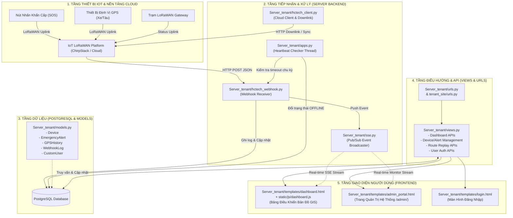
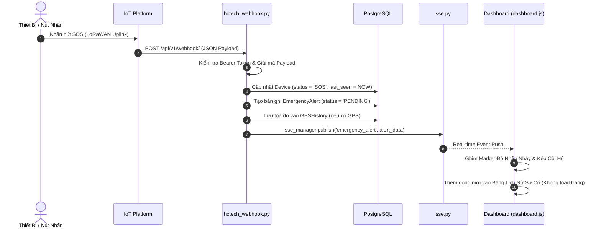
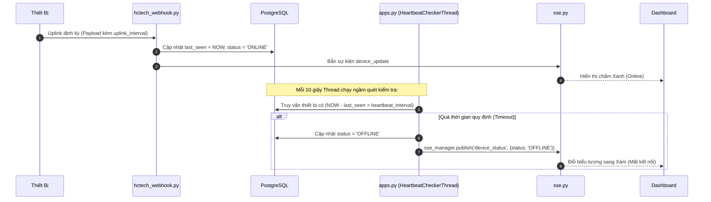
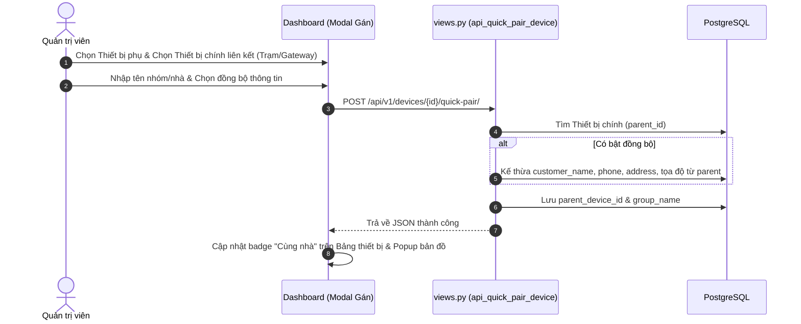
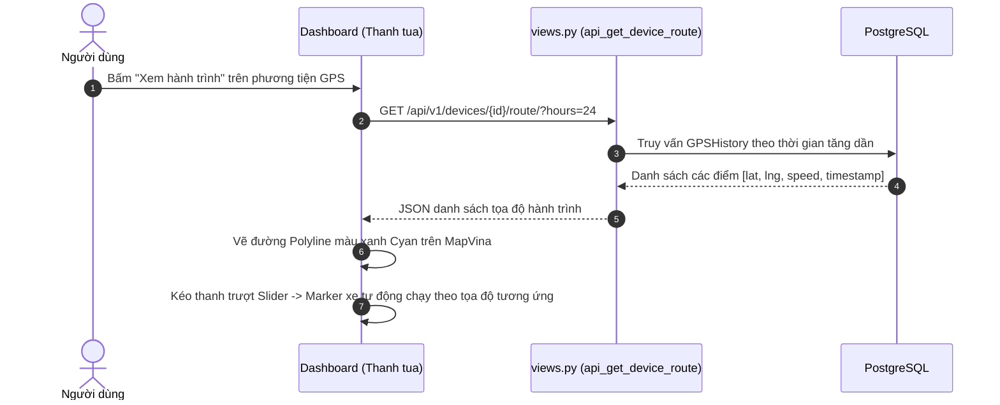

# BẢN ĐỒ KIẾN TRÚC & SƠ ĐỒ HOẠT ĐỘNG CÁC FILE TRONG SERVER
> **Dự án**: Trung Tâm Quản Lý Sự Cố, Cảnh Báo Khẩn Cấp & Giám Sát IoT LoRaWAN (Tenant Site)  
> **Ngôn ngữ & Nền tảng**: Python 3.14, Django 5.x, PostgreSQL, Leaflet GIS, Server-Sent Events (SSE)

---

## 1. SƠ ĐỒ TỔNG THỂ KIẾN TRÚC HỆ THỐNG (SYSTEM OVERVIEW)



---

## 2. BẢNG TRA CỨU NHIỆM VỤ CHI TIẾT CỦA TỪNG FILE

### 2.1. Cấu hình lõi & Khởi động Dự án (Project Core)

| File | Đường dẫn | Nhiệm vụ chính (Core Responsibility) | Thành phần quan trọng |
| :--- | :--- | :--- | :--- |
| **`settings.py`** | `tenant_site/settings.py` | Cấu hình toàn bộ dự án Django: kết nối DB PostgreSQL, auth model `CustomUser`, thời gian timezone, static files, middleware. | `AUTH_USER_MODEL`, `DATABASES`, `INSTALLED_APPS` |
| **`urls.py`** (Root) | `tenant_site/urls.py` | Điểm tiếp nhận routing cao nhất, chuyển tiếp tất cả request vào `Server_tenant.urls`. | `include('Server_tenant.urls')` |
| **`manage.py`** | `manage.py` | CLI điều hành Django (chạy server, migration, seed data). | `execute_from_command_line` |
| **`docker-compose.yml`** | `docker-compose.yml` | Khởi tạo 2 container: `postgres_db` (Port 5433) và `django_app` (Port 5000). | `postgres:16-alpine`, `django_app` service |
| **`entrypoint.sh`** | `entrypoint.sh` | Chờ DB sẵn sàng, chạy migration tự động, seed dữ liệu mẫu ban đầu và bật server. | `python manage.py migrate`, `seed_data` |

---

### 2.2. Xử lý Logic Nghiệp vụ & Dữ liệu (Backend Core App: `Server_tenant/`)

| File | Đường dẫn | Nhiệm vụ chính | Các hàm / Model / API quan trọng |
| :--- | :--- | :--- | :--- |
| **`models.py`** | `Server_tenant/models.py` | **Định nghĩa lược đồ CSDL:**<br>• `Device`: Thông tin thiết bị, DevEUI, tọa độ, chu kỳ heartbeat, nhóm cùng nhà (`parent_device`), trạng thái ONLINE/SOS/OFFLINE.<br>• `EmergencyAlert`: Sự cố khẩn cấp, loại cảnh báo, trạng thái xử lý, tọa độ và ghi chú.<br>• `GPSHistory`: Lịch sử tọa độ GPS theo thời gian để vẽ lộ trình và phát lại hành trình (Route Replay).<br>• `WebhookLog`: Lưu nhật ký bản tin thô JSON từ platform gửi về.<br>• `CustomUser`: Tài khoản phân quyền (Superuser, Tenant Admin, Viewer). | `Device`, `EmergencyAlert`, `GPSHistory`, `WebhookLog`, `CustomUser` |
| **`hctech_webhook.py`** | `Server_tenant/hctech_webhook.py` | **Cổng tiếp nhận Webhook từ Platform IoT:**<br>• Xác thực Bearer Token.<br>• Phân tích Payload LoRaWAN (FPort, Pin, GPS, SOS).<br>• Tự động tạo hoặc cập nhật thiết bị.<br>• Kích hoạt bản ghi `EmergencyAlert` khi có cờ SOS.<br>• Ghi điểm tọa độ vào `GPSHistory`.<br>• Bắn tín hiệu real-time qua `sse.py`. | `hctech_webhook_receiver()`, `parse_lora_payload()`, `trigger_emergency_alert()` |
| **`views.py`** | `Server_tenant/views.py` | **Toàn bộ Controller & REST API của Server:**<br>• Render UI (Dashboard, Login, Admin).<br>• Quản lý thiết bị: Đăng ký, cập nhật, xóa, gán cùng nhà (Quick Pair).<br>• Xử lý sự cố: Lấy danh sách, đánh dấu hoàn thành, phát cảnh báo thủ công.<br>• Lộ trình: Truy vấn tọa độ theo mốc thời gian, xuất file GPX.<br>• Quản trị user: Tạo mới, đổi mật khẩu, phân quyền. | `dashboard_view()`, `api_get_devices()`, `api_get_alerts()`, `api_get_device_route()`, `api_quick_pair_device()` |
| **`apps.py`** | `Server_tenant/apps.py` | **Khởi động ứng dụng & Quét Heartbeat ngầm:**<br>• Chạy background thread định kỳ quét `Device.objects.all()`.<br>• So sánh: `hiện tại - last_seen > heartbeat_interval`.<br>• Tự động chuyển thiết bị sang `OFFLINE` và phát SSE. | `ServerTenantConfig.ready()`, `HeartbeatCheckerThread` |
| **`sse.py`** | `Server_tenant/sse.py` | **Kênh truyền phát Real-time (Server-Sent Events):**<br>• Quản lý hàng đợi tin nhắn (Queue) cho các tab trình duyệt.<br>• Giúp Dashboard cập nhật ngay khi có sự cố, thiết bị đổi trạng thái mà không cần reload trang. | `sse_manager.subscribe()`, `sse_manager.publish()`, `sse_stream()` |
| **`hctech_client.py`** | `Server_tenant/hctech_client.py` | **Giao tiếp 2 chiều với Cloud IoT Platform:**<br>• Gửi lệnh Downlink xuống thiết bị (đổi chu kỳ, reboot).<br>• Đồng bộ danh bạ thiết bị từ Cloud về Tenant Server. | `IoTCloudClient.send_downlink()`, `sync_devices_from_cloud()` |
| **`urls.py`** (App) | `Server_tenant/urls.py` | **Khai báo toàn bộ đường dẫn URL:**<br>• Trang chủ: `/`<br>• Đăng nhập/Đăng xuất: `/login/`, `/logout/`<br>• Webhook: `/api/v1/webhook/`<br>• SSE Stream: `/api/v1/sse/events/`<br>• Các API `/api/v1/...` | `urlpatterns` |

---

### 2.3. Tầng Giao Diện & Client Script (`templates/` & `static/`)

| File | Đường dẫn | Nhiệm vụ chính |
| :--- | :--- | :--- |
| **`dashboard.html`** | `Server_tenant/templates/dashboard.html` | Trung tâm điều hành chính: Bản đồ MapVina GIS, thanh thẻ thống kê, bảng danh sách thiết bị, bảng lịch sử sự cố real-time, thanh tua lại lộ trình GPS, modal gán thiết bị cùng nhà. |
| **`dashboard.js`** | `Server_tenant/static/js/dashboard.js` | Javascript điều phối toàn bộ Dashboard: Kết nối SSE nhận sự kiện, vẽ marker bản đồ động, phát âm thanh báo động SOS, tua lại hành trình (play/pause/seek), lọc bảng thiết bị. |
| **`dashboard.css`** | `Server_tenant/static/css/dashboard.css` | Hệ thống token màu sắc, styling form/textbox chuẩn enterprise, hiệu ứng morphing Logo ⟷ Taskbar, pin hiệu ứng nhấp nháy đỏ SOS trên bản đồ. |
| **`admin_portal.html`** | `Server_tenant/templates/admin_portal.html` | Trang quản trị hệ thống chuyên sâu dành riêng cho Superuser: Monitor Webhook trực tiếp, bộ sinh Downlink, công cụ dọn dẹp log GPS/Alert, giả lập sự cố. |
| **`login.html`** | `Server_tenant/templates/login.html` | Giao diện đăng nhập an toàn, thiết kế tối giản, hỗ trợ xem/ẩn mật khẩu và tự động thích ứng với thiết bị di động. |

---

### 2.4. Công Cụ Hỗ Trợ & Bộ Kịch Bản Kiểm Thử (`management/` & `testfile/`)

| File | Đường dẫn | Nhiệm vụ chính |
| :--- | :--- | :--- |
| **`seed_data.py`** | `Server_tenant/management/commands/seed_data.py` | Lệnh `python manage.py seed_data`: Khởi tạo sẵn tài khoản `admin`, `tenant` và nạp 15 thiết bị mẫu kèm lịch sử tọa độ GPS khi vừa tạo database. |
| **`test_sos.py`** | `testfile/test_sos.py` | Bắn giả lập bản tin Webhook khẩn cấp (SOS Flag = 1) vào server để kiểm tra quy trình báo động và phát âm thanh. |
| **`test_heartbeat.py`** | `testfile/test_heartbeat.py` | Giả lập chu kỳ gửi tin định kỳ của các thiết bị để kiểm tra logic tính toán Online/Offline dựa trên thời gian uplink. |
| **`test_route_replay.py`** | `testfile/test_route_replay.py` | Bắn chuỗi tọa độ GPS liên tiếp để kiểm tra tính năng vẽ đường đi và tua lại hành trình của phương tiện. |

---

## 3. CÁC LUỒNG HOẠT ĐỘNG CHÍNH (SEQUENCE DIAGRAMS)

### 3.1. Luồng tiếp nhận & Xử lý Báo động Khẩn cấp (SOS Flow)



---

### 3.2. Luồng Kiểm Tra Online / Offline qua Heartbeat (Heartbeat & Status Flow)



---

### 3.3. Luồng Gán Thiết Bị Cùng Nhà / Cùng Nhóm (Quick Pair Flow)



---

### 3.4. Luồng Tua Lại Hành Trình Di Chuyển (GPS Route Replay Flow)



---

## 4. TỔNG KẾT MỐI QUAN HỆ GIỮA CÁC FILE

```
├── Dữ liệu vào:
│   └── hctech_webhook.py  <-- Nhận JSON từ Platform LoRaWAN
│
├── Lưu trữ & Trạng thái:
│   ├── models.py          <-- Cấu trúc bảng Database
│   └── apps.py            <-- Quét kiểm tra trạng thái Online/Offline ngầm
│
├── Xử lý yêu cầu & Tương tác:
│   ├── views.py           <-- Cung cấp API & dữ liệu cho giao diện
│   ├── urls.py            <-- Định tuyến kết nối từ client
│   └── sse.py             <-- Cầu nối truyền tin tức thời (Server -> Client)
│
├── Giao diện người dùng:
│   ├── dashboard.html/js  <-- Bản đồ tác chiến, quản lý thiết bị & sự cố
│   ├── admin_portal.html  <-- Giám sát webhook, downlink & dọn dẹp hệ thống
│   └── login.html         <-- Cổng xác thực người dùng
│
└── Điều khiển thiết bị ngược lại:
    └── hctech_client.py   <-- Gửi lệnh Downlink từ server ngược lại thiết bị
```
